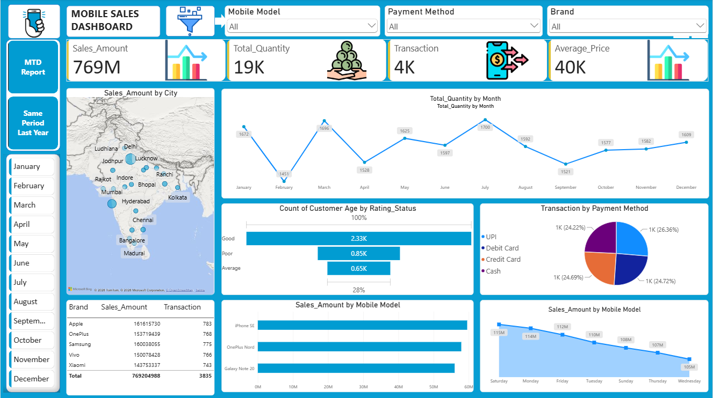
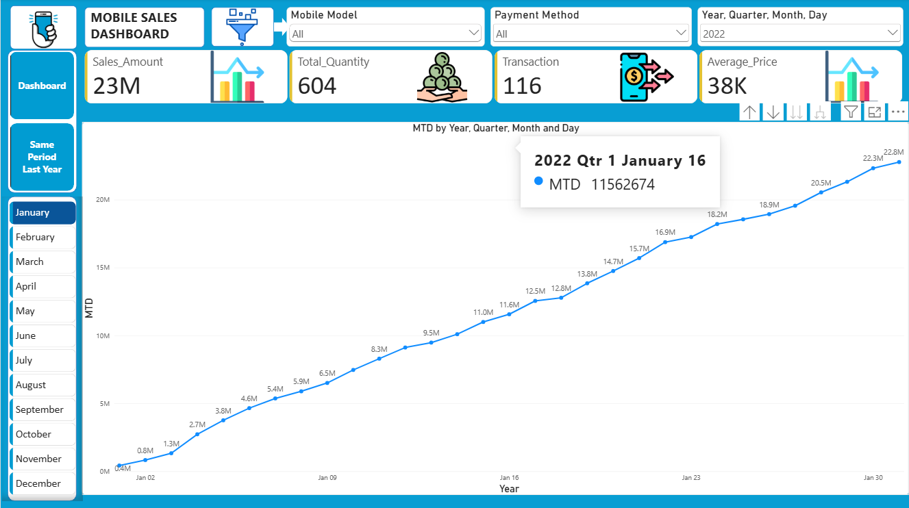
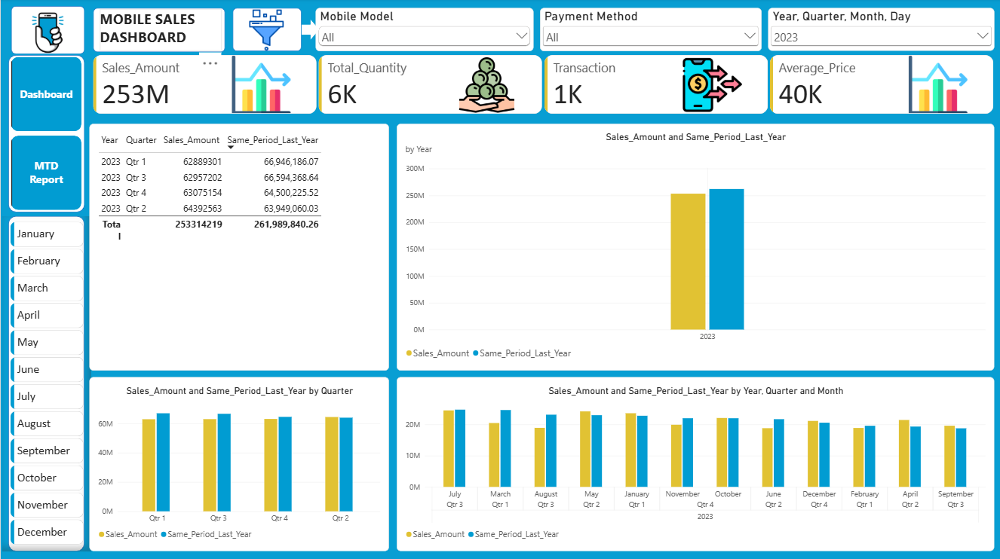

# 📱 Mobile Sales Analysis | Power BI Portfolio Project

[](https://powerbi.microsoft.com/)
[](https://learn.microsoft.com/en-us/dax/)
[](https://www.microsoft.com/en-us/microsoft-365/excel)

An interactive, multi-page Power BI sales dashboard analyzing **₹769M+** in retail smartphone sales across **19 Indian cities** (2021–2024). Designed for sales leaders to track KPIs, evaluate month-to-date (MTD) pacing, and compare Year-over-Year (YoY) performance.

---

## 🎯 Executive Summary & KPIs

| Metric | Figure | Business Context |
| :--- | :--- | :--- |
| **Total Revenue** | **₹769M** | Across 5 major brands (Apple, Samsung, OnePlus, Vivo, Xiaomi) |
| **Units Sold** | **19,150** | Strongest demand in Q1 (March) and Q3 (July) |
| **Total Orders** | **3,835** | High digital payment adoption (UPI 26.4%, Cards 49.4%) |
| **Avg. Selling Price** | **₹40.2K** | Apple (₹161.6M) and Samsung (₹160.0M) drive top revenue |

---

## 🖥️ Dashboards

### 1. Executive Sales Overview
> [`Mobile_Sales_Dashboard.pbix`](Mobile_Sales_Dashboard.pbix) · Core business KPIs, geospatial demand, brand market share, and customer ratings.



- **Geospatial Intelligence:** City-level revenue distribution across 19 markets (Delhi, Mumbai, Bengaluru, etc.).
- **Product & Brand Performance:** Revenue comparison across Apple, Samsung, OnePlus, Vivo, and Xiaomi.
- **Customer Segmentation:** Funnel analysis of customer age demographics vs. satisfaction ratings (60.7% rated 4–5★).

---

### 2. Month-to-Date (MTD) & YoY Growth (SPLY)
> [`Mobile_Sales_MTD.pbix`](Mobile_Sales_MTD.pbix) & [`Mobile_Sales_Same_Period_Last_Year.pbix`](Mobile_Sales_Same_Period_Last_Year.pbix)

| MTD Cumulative Pacing | Same Period Last Year (SPLY) Comparison |
| :---: | :---: |
|  |  |
| *Tracks daily target pacing against monthly quotas* | *DAX time intelligence comparing current vs. prior year performance* |

---

## 🛠️ Technical Stack & Skills Demonstrated

- **Business Intelligence & Reporting:** Power BI Desktop, Custom UI Layouts, Bookmarks & Page Navigation, Conditional Formatting.
- **Data Modeling & Transformation:** Star schema modeling, data cleansing & normalization using Power Query.
- **Time Intelligence & DAX:**
  ```dax
  // SPLY Calculation (Year-over-Year Comparison)
  Sales_SPLY = CALCULATE([Total_Sales], SAMEPERIODLASTYEAR('Calendar'[Date]))

  // MTD Target Pacing
  Sales_MTD = TOTALMTD([Total_Sales], 'Calendar'[Date])

  // Dynamic Revenue Metric
  Total_Sales = SUMX('Sales_Data', 'Sales_Data'[Units Sold] * 'Sales_Data'[Price Per Unit])
  ```

---

## 💡 Key Business Insights

1. **Top Revenue Drivers:** **Apple** (₹161.6M) and **Samsung** (₹160.0M) lead total sales; top-selling models include **iPhone SE** (₹59.6M) and **OnePlus Nord** (₹57.9M).
2. **Payment Trends:** Cash transactions have shrunk to 24.2%, with **UPI leading at 26.4%**, indicating high digital checkout preference.
3. **Customer Satisfaction:** Over **60%** of transactions received 4–5 star ratings, indicating strong brand loyalty.

---

## 🚀 Quick Start

1. Clone repository:
   ```bash
   git clone https://github.com/Devender-Mathela/Power-BI-Mobile-Sales-Analysis.git
   ```
2. Open any `.pbix` file in **[Power BI Desktop](https://powerbi.microsoft.com/desktop/)**.

---

## 📬 Contact & Author

- **Devender Mathela** — [GitHub Profile](https://github.com/Devender-Mathela)
- **Project Repo:** [Power-BI-Mobile-Sales-Analysis](https://github.com/Devender-Mathela/Power-BI-Mobile-Sales-Analysis)
